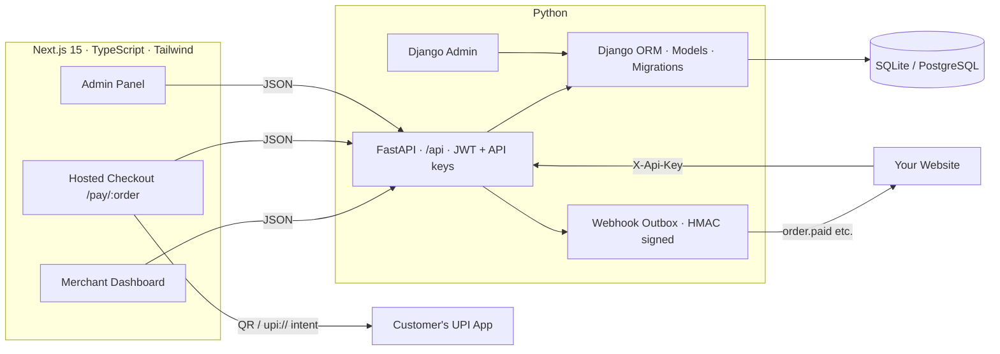

<div align="center">

# ⚡ PayFlow — Open-Source UPI Payment Gateway

**Collect UPI payments on your website with 0% transaction fees — money lands directly in your bank account.**

Self-hosted alternative to Razorpay / Cashfree for UPI collections, built with **Django + FastAPI + Next.js**.

[](https://www.python.org/)
[](https://www.djangoproject.com/)
[](https://fastapi.tiangolo.com/)
[](https://nextjs.org/)
[](https://www.typescriptlang.org/)
[](LICENSE)
[](#-contributing)

[Features](#-features) · [Architecture](#-architecture) · [Quick Start](#-quick-start) · [API](#-merchant-api) · [Webhooks](#-webhooks) · [Screenshots](#-how-it-works)

</div>

---

## 🤔 Why PayFlow?

Payment gateways charge **~2% per transaction** and settle your money after T+2 days. For UPI payments in India, that fee is pure overhead — UPI itself is free.

PayFlow gives you the full "payment gateway experience" — **payment links, hosted checkout page with QR code, order tracking, merchant dashboard, REST API and signed webhooks** — on top of your **own UPI ID**, so:

| | PayFlow (manual UPI) | Razorpay / Cashfree |
|---|---|---|
| Transaction fee | **₹0 (0%)** | ~2% |
| Settlement | **Instant, direct to your bank** | T+2 days |
| KYC / onboarding | None — just your UPI ID | Merchant KYC, approval wait |
| Self-hosted / your data | ✅ | ❌ |
| Payment verification | Customer submits UTR → you approve | Automatic |

> 💡 PayFlow is ideal for indie hackers, small businesses, freelancers and side-projects collecting UPI payments in India without giving up 2% of revenue.

---

## ✨ Features

- 🔗 **Payment links** — create an order, share a link, get paid
- 📱 **Hosted checkout page** — dark glassmorphism UI with dynamic **UPI QR code**, `upi://` deep links (GPay / PhonePe / Paytm / BHIM), live countdown timer and auto status polling
- 🧾 **UTR verification flow** — customer submits their UPI transaction reference (UTR); merchant approves/rejects from the dashboard
- 📊 **Merchant dashboard** — collections stats, 7-day chart, order management, multiple UPI accounts with rotation, limits and defaults
- 🔑 **Merchant REST API** — create & track orders from your own website with `X-Api-Key` / `X-Api-Secret` (live + sandbox key pairs)
- 🪝 **Signed webhooks** — HMAC-SHA256 signed events (`order.paid`, `order.review`, `order.expired`) with retry + **outbox queue** (exponential backoff, retention pruning)
- 🧪 **Sandbox mode** — full test environment with simulated payments, separate API keys and webhooks
- 🛡️ **Admin panel** — merchant management, all-orders view, manual payment override with audit logs, transaction debugger + Django Admin built in
- 🐍 **Django ORM + FastAPI** — Django for models/migrations/admin, FastAPI for a fast async-ready JSON API with auto Swagger docs

---

## 🏗 Architecture



**Payment lifecycle:** `pending` → customer pays & submits UTR → `review` → merchant approves → `paid` (webhook fired) · auto-`expired` on timeout.

---

## 🚀 Quick Start

### Prerequisites

- Python 3.11+
- Node.js 18+

### 1. Backend (Django + FastAPI)

```bash
cd backend
python -m venv .venv
# Windows: .venv\Scripts\activate · Linux/Mac: source .venv/bin/activate
pip install -r requirements.txt

python manage.py migrate
python run_api.py          # FastAPI on http://127.0.0.1:8001
```

- Swagger docs → `http://127.0.0.1:8001/docs`
- Django Admin → `python manage.py createsuperuser` then `python manage.py runserver`

### 2. Frontend (Next.js)

```bash
cd frontend
npm install
# .env.local → NEXT_PUBLIC_API_URL=http://127.0.0.1:8001/api
npm run dev                # http://localhost:3000
```

### 3. First payment in 60 seconds

1. Register at `/register` → add your **UPI ID** under *UPI Accounts*
2. *New payment link* → enter amount → share `/pay/ORDxxxx` with the customer
3. Customer scans QR, pays, submits UTR → order moves to **review**
4. Match the UTR in your bank app → **Approve** → order **paid**, webhook fired ✅

---

## 🔌 Merchant API

Integrate PayFlow into your own website. Keys live in **Settings → API Keys** (separate live `pk_live_*` and sandbox `pk_test_*` pairs).

**Create an order**

```bash
curl -X POST http://127.0.0.1:8001/api/v1/orders \
  -H "X-Api-Key: pk_live_..." \
  -H "X-Api-Secret: sk_live_..." \
  -H "Content-Type: application/json" \
  -d '{"amount": 499, "note": "Pro plan", "customer_name": "Ravi"}'
```

```json
{
  "order_no": "ORD7A0303EC10",
  "status": "pending",
  "pay_url": "/pay/ORD7A0303EC10",
  "upi_intent": "upi://pay?pa=you@upi&am=499.00&tn=ORD7A0303EC10&cu=INR",
  "expires_at": "2026-11-10T04:50:19Z"
}
```

| Endpoint | Description |
|---|---|
| `POST /api/v1/orders` | Create a payment order |
| `GET /api/v1/orders/{order_no}` | Fetch order status |
| `GET /api/v1/orders` | List orders (paginated, filterable) |
| `POST /api/v1/orders/{order_no}/recheck` | Re-run payment verification |
| `GET /api/v1/accounts` | List your UPI accounts |

Full interactive reference: **`/docs`** (Swagger) · **`/redoc`**

---

## 🪝 Webhooks

Every status change POSTs a **HMAC-SHA256 signed** payload to your webhook URL (3 inline retries + durable outbox queue with exponential backoff).

```json
{
  "event": "order.paid",
  "order": { "order_no": "ORD7A0303EC10", "amount": "499.00", "status": "paid", "utr": "325411223344" }
}
```

Verify the `X-Webhook-Signature` header:

```python
import hmac, hashlib

def verify(secret: str, raw_body: bytes, signature: str) -> bool:
    expected = hmac.new(secret.encode(), raw_body, hashlib.sha256).hexdigest()
    return hmac.compare_digest(expected, signature)
```

Operations:

```bash
python manage.py dispatch_outbox --loop     # background webhook worker
python manage.py prune_webhook_logs --days 30
```

---

## 🖥 How it works

| Page | What you get |
|---|---|
| **Checkout** `/pay/{order}` | QR code, UPI app deep-links, countdown ring, UTR form, live status |
| **Dashboard** | Today/total collected, success rate, 7-day chart, review queue |
| **Orders** | Filter/search, approve/reject UTR, mark paid, recheck |
| **UPI Accounts** | Multiple VPAs, default selection, daily limits, enable/disable |
| **Settings** | API keys (live/sandbox), webhook URLs + secrets, password |
| **Admin** | Merchants, all orders, manual override + audit log, txn debugger |
| **Sandbox** `/sandbox/pay/{order}` | Simulate success/failure — no real money |

---

## 🧱 Tech Stack

**Backend:** Python · Django 6 (ORM, migrations, admin) · FastAPI (REST, JWT, Swagger) · PyJWT · httpx · qrcode
**Frontend:** Next.js 15 (App Router) · React 19 · TypeScript · Tailwind CSS
**Database:** SQLite by default — swap `DATABASES` in `backend/core/settings.py` for PostgreSQL/MySQL in production

---

## 🗺 Roadmap

- [ ] Paytm Business API auto-verification (0% fees + automatic)
- [ ] SMS/notification-based auto-matching of incoming UPI credits
- [ ] PhonePe PG / Paytm PG hosted checkout (optional, fee-based, fully automatic)
- [ ] Settlement/reconciliation exports (CSV)
- [ ] Docker Compose one-command deploy
- [ ] Rate limiting & brute-force protection hardening

---

## ⚠️ Disclaimer

PayFlow's manual mode relies on **customer-submitted UTRs verified by the merchant**. Always match the UTR against your actual bank/UPI statement before approving. This software is provided as-is under the MIT license — audit it before using in production and comply with local payment regulations.

---

## 🤝 Contributing

Stars ⭐, issues and PRs are very welcome!

1. Fork → `git checkout -b feat/my-feature`
2. Commit → `git push` → open a PR

---

## 📄 License

[MIT](LICENSE) © [Pawan Kumar](https://github.com/pawan941394)

<div align="center">

**If PayFlow saves you 2% in gateway fees, a ⭐ costs 0%.**

*Keywords: UPI payment gateway · India payments · zero fee UPI collection · Razorpay alternative · self-hosted payment gateway · FastAPI Django payment API · Next.js checkout · UPI QR code payments · UTR verification · payment links*

</div>
